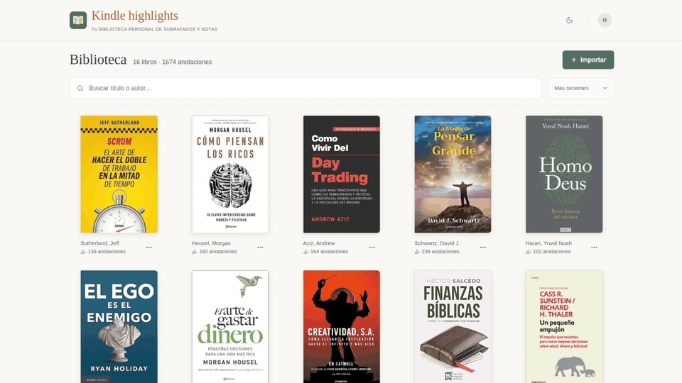

# Kindle highlights

Tu biblioteca personal de subrayados y notas de Kindle.

## Demo



## Funciones

- **Varios usuarios:** cada cuenta tiene una biblioteca privada e independiente.
- **Importación de Kindle:** importa subrayados y notas desde archivos HTML o HTM.
- **Sin duplicados al reimportar:** añade las anotaciones nuevas y omite las repetidas, conservando las ediciones y portadas existentes.
- **Edición conservando el original:** modifica subrayados y notas y consulta su texto original cuando lo necesites.
- **Eliminación de contenido:** elimina subrayados o notas individualmente, o un libro completo con sus anotaciones y portada.
- **Libros personalizables:** edita el título y el autor sin perder su reconocimiento al reimportar.
- **Portadas propias:** añade, sustituye o elimina las portadas de tus libros.
- **Búsqueda y ordenación:** busca libros por título o autor y ordénalos por actividad reciente, título o autor.
- **Lectura de anotaciones:** busca dentro de cada libro, filtra subrayados o notas y expande o contrae sus secciones.
- **Copiar texto:** copia el contenido de un subrayado o nota al portapapeles.
- **Modo claro y oscuro:** cambia de tema y conserva tu preferencia en el navegador.
- **Diseño adaptable:** utiliza la biblioteca desde un computador, tableta o dispositivo móvil.
- **PWA instalable:** instala la aplicación desde el navegador.
- **Datos persistentes:** libros, anotaciones, ediciones y portadas se guardan en la base de datos y se conservan entre reinicios.

## Instalación

Requiere Docker y Docker Compose. Prepara el archivo `.env` a partir de `.env.example`. Para más información sobre la base de datos consulta el archivo [docs/database.md](docs/database.md). 

Desde la raíz del proyecto ejecuta:
```bash
docker compose up -d --build
```

Abre [http://127.0.0.1:3001](http://127.0.0.1:3001) si ejecutas la aplicación en tu equipo. Si la instalas en un servidor, accede mediante `http://IP_DEL_SERVIDOR:3001`; su firewall debe permitir el puerto 3001.

PostgreSQL crea la base al inicializar un volumen vacío y la aplicación instala el esquema automáticamente si la base está vacía.

Para arrancar otra vez sin haber hecho cambios en el código ejecuta:
```bash
docker compose up -d
```

Si realizaste cambios en el código, usa de nuevo `--build`.

Para detener los contenedores ejecuta:
```bash
docker compose stop
```
Los datos no se pierden al detener los contenedores.

Para revisar los logs ejecuta:
```bash
docker compose logs --follow app
```

## PWA

Puedes instalar la aplicación en tu dispositivo móvil desde el navegador una vez que esté desplegada en un servidor.

- Abre la aplicación mediante HTTPS con un certificado reconocido por el dispositivo.
- En los navegadores compatibles, abre el menú de tu cuenta y elige **Instalar aplicación**. También puedes utilizar la opción de instalación del navegador.
- En iPhone o iPad, abre el menú **Compartir** del navegador y elige **Agregar a pantalla de inicio**.

Consultar y modificar contenido requiere conexión con el servidor.

## Desarrollo

Requiere Node.js 22.19 o posterior, Docker y Docker Compose. En desarrollo, PostgreSQL se ejecuta en Docker y Vite y la API se ejecutan en tu equipo. Desde la raíz del proyecto:

1. Prepara `.env` a partir de `.env.example`, configura `PGDATABASE`, `PGUSER` y `PGPASSWORD`, y añade la dirección y puerto de la base para el backend local:

   ```dotenv
   PGHOST=127.0.0.1
   PGPORT=5432
   ```

2. Inicia sólo la base de datos y espera a que esté disponible:

   ```bash
   docker compose up -d --wait database
   ```

   Este comando inicia el servicio `database`, sin arrancar `app`. Si `app` ya estaba ejecutándose de una sesión anterior, detenlo con `docker compose stop app` para liberar el puerto 3001. La opción `--wait` espera a que PostgreSQL supere su comprobación de salud; si falla, resuelve el error antes de continuar.

3. Instala las dependencias y arranca Vite y la API:

   ```bash
   npm ci
   npm run dev
   ```

Abre [http://127.0.0.1:5173](http://127.0.0.1:5173). Vite utiliza el puerto 5173 y la API, el 3001. La API crea el esquema automáticamente si la base está vacía.

Para terminar, pulsa `Ctrl+C` en la terminal de desarrollo. PostgreSQL sigue ejecutándose; puedes detenerlo con `docker compose stop database`, conservando sus datos.

## Documentación

| Guía                                 | Contenido |
|--------------------------------------| --- |
| [Arquitectura](docs/architecture.md) | Organización del código y flujo de datos. |
| [Base de datos](docs/database.md)    | Configuración, inicialización, tablas, backups y restauración. |
