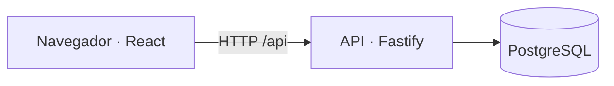

# Arquitectura

La interfaz utiliza React y TypeScript. La API utiliza Fastify y guarda los datos en PostgreSQL.

En desarrollo, Vite sirve la interfaz y redirige `/api` al backend. En Docker, Fastify sirve tanto la web compilada como la API.

## Organización del código

| Ruta | Responsabilidad |
| --- | --- |
| `client/App.tsx` | Composición de la aplicación. |
| `client/features/` | Pantallas y funciones de biblioteca, libros, anotaciones e importación. |
| `client/components/` | Componentes compartidos: encabezado, footer, portadas y diálogos. |
| `client/hooks/` | Estado de la biblioteca, sesión, tema y menús. |
| `client/api/` | Solicitudes HTTP al backend. |
| `client/styles.css` | Estilos y temas claro y oscuro. |
| `server/index.ts` | Arranque y cierre del servidor. |
| `server/app.ts` | Rutas y validación de peticiones. |
| `server/auth/` | Credenciales y sesiones. |
| `server/repositories/` | Consultas y operaciones de biblioteca en PostgreSQL. |
| `server/parser.ts` | Extracción de libros y anotaciones del HTML de Kindle. |
| `server/db/` y `server/storage.ts` | Conexión e inicialización de la base. |
| `shared/` | Tipos, límites y funciones compartidos entre cliente y servidor. |
| `database/schema.sql` | Esquema de la base de datos. |

## Flujo de una operación

1. La interfaz realiza una solicitud mediante `client/api/`.
2. La API comprueba la sesión y valida los datos recibidos.
3. El repositorio consulta o modifica únicamente la biblioteca del usuario autenticado.
4. La API devuelve el resultado y la interfaz actualiza su estado.

Los libros, anotaciones, portadas y sesiones se guardan en PostgreSQL. El navegador conserva la preferencia de tema.
