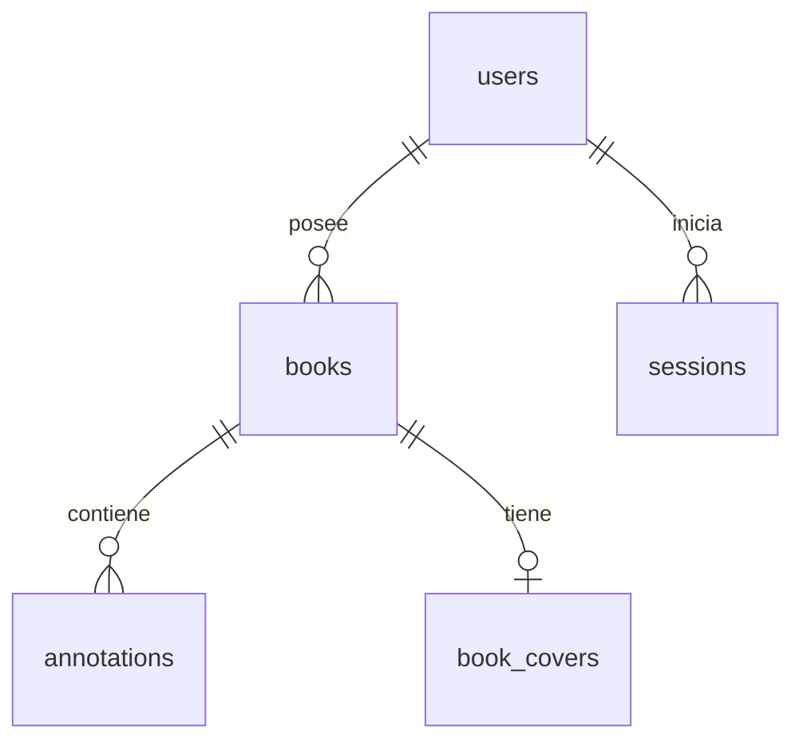

# Base de datos

La aplicación utiliza PostgreSQL 18.

Compose ejecuta `database` y la aplicación en contenedores separados, con un volumen nombrado `postgres_data` para los datos.

Los comandos de esta guía usan `compose.yaml`. Para producción usando la imagen publicada en Docker Hub, sustituye `docker compose` por `docker compose -f compose.prod.yaml`. El nombre del proyecto Compose determina qué volumen se utiliza; conserva el de tu despliegue existente.

## Configuración

La plantilla `.env.example` contiene valores de ejemplo para el archivo de configuración `.env`. Puedes generar el archivo `.env` con el siguiente comando:

```bash
cp -n .env.example .env
```

Edita el archivo creado y sustituye los valores de ejemplo:

| Variable | Uso |
| --- | --- |
| `PGDATABASE` | Nombre de la base de esta aplicación. |
| `PGUSER` | Rol PostgreSQL con el que se conecta el servidor. |
| `PGPASSWORD` | Contraseña de ese rol. |

La imagen crea la base y el rol sólo al inicializar un volumen vacío. Cambiar esas variables después no modifica las credenciales ya guardadas.

Para ejecutar el backend fuera de Docker se necesitan además `PGHOST` y `PGPORT`, apuntando a la base elegida.

## Tablas



| Tabla | Datos y reglas principales                                                                                               |
| --- |--------------------------------------------------------------------------------------------------------------------------|
| `users` | UUID, username case insensitive , hashes de contraseña y recuperación, fechas de creación y último acceso. |
| `sessions` | Hash del token, propietario y vencimiento. Cerrar sesión elimina su fila.                                                |
| `books` | Propietario, título/autor visibles, metadatos originales y huella de importación única por propietario.                  |
| `annotations` | Tipo, texto original, última edición opcional, página, posición, sección, capítulo, orden y huella única por libro.      |
| `book_covers` | Imagen binaria opcional por libro, MIME y UUID de versión que cambia con cada sustitución.                               |

Eliminar un libro elimina sus anotaciones y portada mediante claves foráneas en cascada.

## Persistencia

El volumen se monta en `/var/lib/postgresql`; la imagen PostgreSQL 18 usa internamente `/var/lib/postgresql/18/docker`.

Reiniciar o recrear los contenedores conserva el volumen.

## Crear un backup

El backup se guarda en el directorio desde donde ejecutes el comando:

```bash
docker compose exec -T database sh -c 'exec pg_dump --username "$POSTGRES_USER" --dbname "$POSTGRES_DB" --format=custom --no-acl' > "kindle-highlights-$(date +%Y%m%d-%H%M%S).dump"
```

## Restaurar un backup

La restauración reemplaza todos los datos actuales por los del backup. No elimines el volumen de PostgreSQL.

Ejecuta los pasos desde la raíz del proyecto, con PostgreSQL encendido y en la misma terminal. Continúa al siguiente paso sólo si el anterior termina sin errores.

1. Selecciona el archivo real de backup y comprueba que exista y que su índice pueda leerse:

   ```bash
   backup_file='REEMPLAZAR_POR_EL_BACKUP.dump'
   test -s "$backup_file" && docker compose exec -T database pg_restore --list < "$backup_file"
   ```

   Sustituye el nombre de ejemplo por el archivo que vas a restaurar. Si no aparece el índice del backup o hay errores, no continúes. Leer el índice no verifica todos los datos del archivo.

2. Detén la aplicación para impedir escrituras y la inicialización automática mientras restauras. Si ejecutaste `npm run dev`, detenlo con `Ctrl+C` en su terminal. Para detener la aplicación en Docker:

   ```bash
   docker compose stop app
   ```

3. Borra y vuelve a crear la base de destino vacía:

   ```bash
   docker compose exec -T database sh -c '
     dropdb --maintenance-db=template1 --username "$POSTGRES_USER" --if-exists --force -- "$POSTGRES_DB" &&
     createdb --maintenance-db=template1 --username "$POSTGRES_USER" --owner "$POSTGRES_USER" -- "$POSTGRES_DB"
   '
   ```

4. Restaura el esquema y los datos en una sola transacción. No inicies la aplicación si falla:

   ```bash
   docker compose exec -T database \
     sh -c 'exec pg_restore --username "$POSTGRES_USER" --dbname "$POSTGRES_DB" --single-transaction --exit-on-error --no-owner --no-acl' \
     < "$backup_file"
   ```

5. Invalida las sesiones recuperadas para que todos vuelvan a iniciar sesión:

   ```bash
   docker compose exec -T database \
     sh -c 'exec psql --username "$POSTGRES_USER" --dbname "$POSTGRES_DB" --set ON_ERROR_STOP=1 --command="DELETE FROM public.sessions;"'
   ```

6. Después de completar los pasos anteriores sin errores, inicia la aplicación según tu entorno: `npm run dev` en desarrollo, o el siguiente comando en Docker. Comprueba el acceso, libros, anotaciones y portadas:

   ```bash
   docker compose up -d
   ```

No ejecutes `database/schema.sql`: el backup ya contiene el esquema.

## Borrar la base e iniciar de cero

**Estos pasos eliminan todas las cuentas, libros, anotaciones y portadas.** Son comandos para ejecución manual desde la raíz del proyecto.

Si quieres conservarlos, realiza primero un [backup](#crear-un-backup).

1. Detén la aplicación y deja PostgreSQL encendido. Si ejecutaste `npm run dev`, detenlo primero con `Ctrl+C` en su terminal:

   ```bash
   docker compose stop app
   docker compose up -d database
   ```

2. Cuando PostgreSQL esté listo, borra y vuelve a crear la base. Continúa sólo si el comando termina sin errores:

   ```bash
   docker compose exec -T database sh -c '
     dropdb --maintenance-db=template1 --username "$POSTGRES_USER" --if-exists --force -- "$POSTGRES_DB" &&
     createdb --maintenance-db=template1 --username "$POSTGRES_USER" --owner "$POSTGRES_USER" -- "$POSTGRES_DB"
   '
   ```

3. Inicia la aplicación según tu entorno: `npm run dev` en desarrollo, o el siguiente comando en Docker sin reconstruir la imagen:

   ```bash
   docker compose up -d
   ```

El servidor creará automáticamente el esquema en la base vacía. Abre la aplicación y registra tu cuenta nuevamente.
